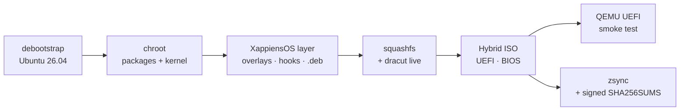
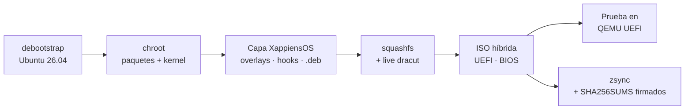

<p align="center">
  
</p>

<p align="center">
  <a href="docs/ROADMAP.md"></a>
  <a href="config/xappiens-os/26.04.mk"></a>
  <a href="docs/DEVELOPMENT.md#base-técnica"></a>
  <a href="docs/DEVELOPMENT.md#base-técnica"></a>
  <a href="LICENSE.md"></a>
</p>

<p align="center">
  <a href="#english"><b>🇬🇧 English</b></a> &nbsp;·&nbsp;
  <a href="#español"><b>🇪🇸 Español</b></a>
</p>

<p align="center">
  <a href="docs/DEVELOPMENT.md">Build guide / Guía técnica</a> &nbsp;·&nbsp;
  <a href="docs/ROADMAP.md">Roadmap</a> &nbsp;·&nbsp;
  <a href="https://github.com/XappiensAI">XappiensAI</a>
</p>

---

## English

<h3 align="center">A modern Linux desktop, engineered from the boot menu up.</h3>

**XappiensOS** is the free operating system by **[Xappiens](https://xappiens.com)**: a long-term-support Ubuntu base, a native Wayland desktop written in Rust, and our own identity on every screen from power-on to sign-in. Developed in the open and shared under the GPL-3.0.

> **Pre-alpha.** The build system and packages are here; full validation on real hardware is in progress. Track it on the [roadmap](docs/ROADMAP.md).

### Why XappiensOS

| | | |
|---|---|---|
| 🪟 | **Native Wayland** | The **COSMIC** desktop, written in Rust: a fast, memory-safe compositor and shell, with no X11 legacy in the way. |
| 🧱 | **Rock-solid LTS base** | **Ubuntu 26.04 LTS** with a current **Linux 7.x** kernel: years of security updates and wide hardware support. |
| ⚡ | **Modern boot chain** | `systemd-boot` + `kernelstub` on the installed system, a `dracut` live image and a themed GRUB menu only where it belongs: on the ISO. |
| 🎨 | **One identity, end to end** | Boot menu, Plymouth splash, installer, logo, hostname and system identity, re-applied on every boot so updates never undo it. |
| 🔁 | **Convert in place** | A single `.deb` turns an existing 26.04 COSMIC system into XappiensOS, keeping your files, apps and settings. No reinstall. |
| 🧪 | **Tested like software** | An automated test suite covers our desktop tools and installer branding, including end-to-end checks inside an isolated Wayland compositor. |

### Under the hood

XappiensOS is not a theme on top of a distro: it is built from scratch, package by package, by a reproducible pipeline.



- **Layered by design.** Everything that makes XappiensOS lives in its own layer (`config/xappiens-os/`, `packaging/`, `branding/`): file overlays and per-stage hooks for the system and the live session. Inherited build files stay almost untouched, so upstream improvements merge cleanly.
- **One command.** `./build.sh` checks dependencies and filesystem, builds our packages, signs the ISO pool and produces the image. Add `qemu` to boot it in a UEFI VM, or `all` for zsync and signed checksums.
- **GPU ready.** `NVIDIA=1 ./build.sh` produces a variant with proprietary NVIDIA drivers.
- **Brand as code.** Installer artwork, boot theme and logo are generated by scripts in [`branding/`](branding/installer/README.md), not hand-edited binaries.

### Get started

```bash
git clone --recurse-submodules https://github.com/XappiensAI/XappiensOS.git
cd XappiensOS
./deps.sh            # build dependencies
./build.sh qemu      # build the ISO and boot it in a UEFI virtual machine
```

Building needs a Linux filesystem (ext4, btrfs, xfs…), about **25 GB free**, `sudo` and an internet connection.

| I want to… | Start here |
|---|---|
| **Build an ISO** | [Build requirements and commands](docs/DEVELOPMENT.md#construir-la-iso) |
| **Convert my current system** | [In-place conversion](docs/DEVELOPMENT.md#convertir-un-sistema-2604-instalado) |
| **Understand the architecture** | [Repository layout](docs/DEVELOPMENT.md#estructura-del-repositorio) |
| **Help build XappiensOS** | [Roadmap](docs/ROADMAP.md), [issues](https://github.com/XappiensAI/XappiensOS/issues) and [contributing](CONTRIBUTING.md) |

<p align="right"><a href="#english">↑ back to top</a></p>

---

## Español

<h3 align="center">Un escritorio Linux moderno, diseñado desde el menú de arranque.</h3>

**XappiensOS** es el sistema operativo libre de **[Xappiens](https://xappiens.com)**: una base Ubuntu de soporte extendido, un escritorio Wayland nativo escrito en Rust y nuestra identidad en cada pantalla, desde que enciendes hasta que inicias sesión. Desarrollado en abierto y compartido bajo la GPL-3.0.

> **Pre-alfa.** El sistema de construcción y los paquetes están aquí; la validación completa en hardware real está en marcha. Síguela en la [hoja de ruta](docs/ROADMAP.md).

### Por qué XappiensOS

| | | |
|---|---|---|
| 🪟 | **Wayland nativo** | El escritorio **COSMIC**, escrito en Rust: compositor y entorno rápidos y seguros en memoria, sin el lastre de X11. |
| 🧱 | **Base LTS sólida** | **Ubuntu 26.04 LTS** con kernel **Linux 7.x**: años de actualizaciones de seguridad y amplio soporte de hardware. |
| ⚡ | **Arranque moderno** | `systemd-boot` + `kernelstub` en el sistema instalado, imagen live con `dracut` y menú GRUB con tema propio solo donde toca: en la ISO. |
| 🎨 | **Una identidad de principio a fin** | Menú de arranque, pantalla Plymouth, instalador, logo, nombre del equipo e identidad del sistema, reaplicados en cada arranque para que ninguna actualización los deshaga. |
| 🔁 | **Conversión en caliente** | Un solo `.deb` convierte un sistema 26.04 con COSMIC en XappiensOS conservando archivos, aplicaciones y ajustes. Sin reinstalar. |
| 🧪 | **Probado como software** | Una batería de pruebas automáticas cubre nuestras herramientas de escritorio y la marca del instalador, con pruebas de extremo a extremo en un compositor Wayland aislado. |

### Bajo el capó

XappiensOS no es un tema sobre otra distribución: se construye desde cero, paquete a paquete, con un proceso reproducible.



- **Por capas.** Todo lo que hace XappiensOS vive en su propia capa (`config/xappiens-os/`, `packaging/`, `branding/`): overlays de ficheros y hooks por etapa para el sistema y la sesión live. Los ficheros heredados del sistema de construcción apenas se tocan, así que las mejoras de upstream se integran sin conflictos.
- **Un solo comando.** `./build.sh` comprueba dependencias y sistema de ficheros, construye nuestros paquetes, firma el pool de la ISO y genera la imagen. Con `qemu` la arranca en una VM UEFI; con `all` añade zsync y sumas firmadas.
- **Listo para GPU.** `NVIDIA=1 ./build.sh` genera una variante con los drivers propietarios de NVIDIA.
- **La marca es código.** Las ilustraciones del instalador, el tema de arranque y el logo se generan con scripts en [`branding/`](branding/installer/README.md), no con binarios editados a mano.

### Empieza por aquí

```bash
git clone --recurse-submodules https://github.com/XappiensAI/XappiensOS.git
cd XappiensOS
./deps.sh            # dependencias de construcción
./build.sh qemu      # construye la ISO y la arranca en una máquina virtual UEFI
```

Para construir necesitas un sistema de ficheros Linux (ext4, btrfs, xfs…), unos **25 GB libres**, `sudo` y conexión a internet.

| Quiero… | Guía |
|---|---|
| **Construir una ISO** | [Requisitos y comandos de construcción](docs/DEVELOPMENT.md#construir-la-iso) |
| **Convertir mi sistema actual** | [Conversión sin reinstalar](docs/DEVELOPMENT.md#convertir-un-sistema-2604-instalado) |
| **Entender la arquitectura** | [Estructura del repositorio](docs/DEVELOPMENT.md#estructura-del-repositorio) |
| **Participar en el proyecto** | [Hoja de ruta](docs/ROADMAP.md), [incidencias](https://github.com/XappiensAI/XappiensOS/issues) y [cómo contribuir](CONTRIBUTING.md) |

<p align="right"><a href="#español">↑ volver arriba</a></p>

---

<p align="center">
  <a href="LICENSE.md"><b>GPL-3.0</b></a> &nbsp;·&nbsp;
  <a href="docs/CREDITS.md">Credits / Créditos</a> &nbsp;·&nbsp;
  <a href="CONTRIBUTING.md">Contributing / Contribuir</a> &nbsp;·&nbsp;
  <a href="https://xappiens.com">xappiens.com</a>
</p>

<p align="center"><sub>© 2026 XappiensAI and contributors · Free software / Software libre</sub></p>
