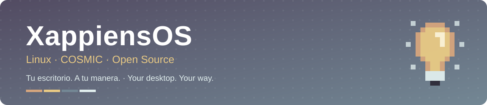
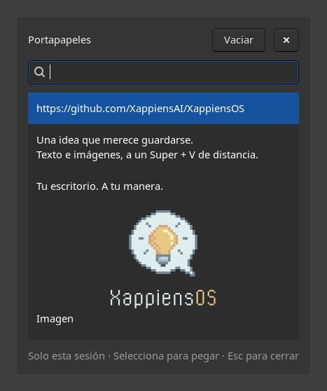

  

  
  
  
  

  <a href="#english"><b>🇬🇧 English</b></a> &nbsp;·&nbsp;
  <a href="#español"><b>🇪🇸 Español</b></a>

  <a href="docs/DEVELOPMENT.md">Build guide / Guía técnica</a> &nbsp;·&nbsp;
  <a href="docs/ROADMAP.md">Roadmap</a> &nbsp;·&nbsp;
  <a href="https://github.com/XappiensAI">XappiensAI</a>

---

## English

**XappiensOS** is the free operating system by **Xappiens**, built on **Ubuntu 26.04 LTS** with the **COSMIC** desktop. A solid, well-known base with our own identity, desktop tools and hardware-specific fixes on top.

Built by **[Xappiens](https://xappiens.com)**, developed in the open, and shared under the GPL-3.0.

> **Pre-alpha.** This repository contains the build system and packages. Validation of the complete ISO, installer and installed system is still pending. Follow the [roadmap](docs/ROADMAP.md) for the current state.

### What comes with XappiensOS

| | Feature | What it does |
|---|---|---|
| 📋 | **Clipboard history** | **Super + V** opens the text and images copied during the session. Pick an entry to paste it into the previous app. |
| ⌨️ | **Custom shortcuts** | Assign a key combination to paste saved text or run a command, with a built-in editor. [Guide](docs/keyboard-shortcuts.md). |
| 💡 | **Our own identity** | System identity, logo, custom Plymouth boot screen, ISO boot menu and a [branded installer](branding/installer/README.md) with our own pixel-art illustrations. |
| 🎧 | **Targeted Bluetooth fixes** | Hardware-specific audio settings and a DKMS fix for the headset microphone issue documented [here](packaging/xappiens-bt-sco-fix-dkms/README.md). |
| 🪐 | **COSMIC desktop** | A modern, fast Wayland desktop, with our tools integrated from the first boot. |

### Copy. Choose. Paste.

Copy a few items, press **Super + V**, and choose with the mouse or the arrow keys and **Enter**. Search, clear the history, or close it with **Escape**. The history stays in memory and ends when you sign out.

  

Actual clipboard tool in an isolated Wayland test session, using sample content.

The tool stores plain text and supported images. See the [clipboard guide](docs/clipboard-history.md) for storage limits, integration and tests.

### Get started

| I want to… | Start here |
|---|---|
| **Build an ISO** | [Build requirements and commands](docs/DEVELOPMENT.md#construir-la-iso) |
| **Use the settings package** | [Install on an existing 26.04 COSMIC system](docs/DEVELOPMENT.md#convertir-un-sistema-2604-instalado) |
| **Understand the code** | [Architecture and repository layout](docs/DEVELOPMENT.md#estructura-del-repositorio) |
| **Test the clipboard** | [Automated and desktop checks](docs/clipboard-history.md#validación-en-una-sesión-cosmic-de-prueba) |
| **Help build XappiensOS** | [Roadmap](docs/ROADMAP.md), [issues](https://github.com/XappiensAI/XappiensOS/issues) and [development checks](docs/DEVELOPMENT.md#pruebas) |

The full settings package targets **26.04 COSMIC systems** ([details](docs/DEVELOPMENT.md)). It changes system identity and must not be installed on 24.04. Building requires a Linux filesystem, about **25 GB free**, `sudo` and an internet connection.

<a href="#english">↑ back to top</a>

---

## Español

**XappiensOS** es el sistema operativo libre de **Xappiens**, basado en **Ubuntu 26.04 LTS** con el escritorio **COSMIC**. Una base sólida y conocida, y encima nuestra identidad, herramientas de escritorio y correcciones para hardware concreto.

Un proyecto de **[Xappiens](https://xappiens.com)**, desarrollado en abierto y compartido bajo la GPL-3.0.

> **Pre-alfa.** Este repositorio contiene el sistema de construcción y los paquetes. La validación de la ISO completa, el instalador y el sistema instalado sigue pendiente. Consulta el estado en la [hoja de ruta](docs/ROADMAP.md).

### Qué incluye XappiensOS

| | Función | Qué aporta |
|---|---|---|
| 📋 | **Historial del portapapeles** | **Super + V** muestra el texto y las imágenes copiados durante la sesión. Selecciona una entrada para pegarla en la aplicación anterior. |
| ⌨️ | **Atajos personalizados** | Asocia combinaciones de teclas a textos guardados o comandos con el editor incluido. [Guía](docs/keyboard-shortcuts.md). |
| 💡 | **Identidad propia** | Identidad del sistema, logo, pantalla de arranque Plymouth, menú de arranque de la ISO e [instalador con nuestra marca](branding/installer/README.md) e ilustraciones pixel-art propias. |
| 🎧 | **Correcciones de Bluetooth** | Ajustes de audio según el hardware y un módulo DKMS para el fallo del micrófono de auriculares descrito [aquí](packaging/xappiens-bt-sco-fix-dkms/README.md). |
| 🪐 | **Escritorio COSMIC** | Un escritorio Wayland moderno y rápido, con nuestras herramientas integradas desde el primer arranque. |

### Copia. Elige. Pega.

Copia varios elementos, pulsa **Super + V** y elige con el ratón o con las flechas y **Enter**. Puedes buscar, vaciar el historial y cerrar con **Escape**. El contenido permanece en memoria y se borra al cerrar sesión.

La captura de arriba muestra la herramienta real en una sesión Wayland aislada con contenido de ejemplo. Guarda texto sin formato e imágenes compatibles; los límites, la integración y las pruebas están en la [guía del portapapeles](docs/clipboard-history.md).

### Empieza por aquí

| Quiero… | Guía |
|---|---|
| **Construir una ISO** | [Requisitos y comandos de construcción](docs/DEVELOPMENT.md#construir-la-iso) |
| **Usar el paquete de ajustes** | [Instalar sobre un sistema 26.04 con COSMIC](docs/DEVELOPMENT.md#convertir-un-sistema-2604-instalado) |
| **Entender el código** | [Arquitectura y estructura del repositorio](docs/DEVELOPMENT.md#estructura-del-repositorio) |
| **Probar el portapapeles** | [Pruebas automáticas y de escritorio](docs/clipboard-history.md#validación-en-una-sesión-cosmic-de-prueba) |
| **Participar en el proyecto** | [Hoja de ruta](docs/ROADMAP.md), [incidencias](https://github.com/XappiensAI/XappiensOS/issues) y [comprobaciones de desarrollo](docs/DEVELOPMENT.md#pruebas) |

El paquete completo de ajustes está dirigido a **sistemas 26.04 con COSMIC** ([detalles](docs/DEVELOPMENT.md)). Cambia la identidad del sistema y no debe instalarse sobre la 24.04. Para construir necesitas un sistema de ficheros Linux, unos **25 GB libres**, `sudo` y conexión a internet.

<a href="#español">↑ volver arriba</a>

---

  <a href="LICENSE.md"><b>GPL-3.0</b></a> &nbsp;·&nbsp;
  <a href="docs/CREDITS.md">Credits / Créditos</a> &nbsp;·&nbsp;
  <a href="CONTRIBUTING.md">Contributing / Contribuir</a> &nbsp;·&nbsp;
  <a href="https://xappiens.com">xappiens.com</a>

© 2026 XappiensAI and contributors · Free software / Software libre

