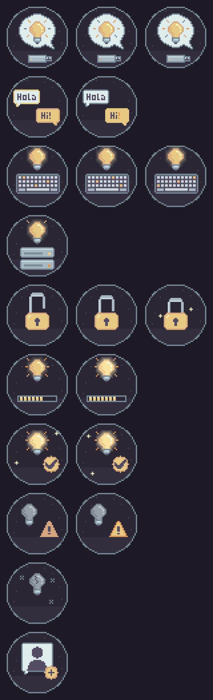

# Instalador, logo y menú de arranque



Ilustraciones pixel-art para cada paso del instalador, el logo del sistema y
el menú de arranque de la ISO, con el mismo estilo y la misma paleta que la
[pantalla de arranque](../plymouth/README.md).

## Qué cambia

| Pieza | Dónde se ve | Cómo se aplica |
| --- | --- | --- |
| Colores del instalador | Toda la ventana del instalador | `gtk.css` de root, por encima del tema `Pop-dark` |
| Ilustraciones | Probar o instalar, idioma, teclado, discos, cifrado, cuenta, progreso, fin, avisos y errores | Mismo `gtk.css`, sustituye las del instalador original |
| "Instalar XappiensOS" e icono | Dock y lista de aplicaciones de la sesión live, pantalla "Probar o instalar" | Desvío (`dpkg-divert`) del `.desktop` y de `system-os-installer` del tema Pop |
| Logo `distributor-logo-xappiens` | Pantalla de progreso del instalador, `LOGO=` de os-release, aplicaciones GTK | Desvío de `distributor-logo` del tema Pop (`set-logo`) |
| Avatar de usuario por defecto | Pantalla "Crear cuenta" e imagen de la cuenta instalada | Desvío de `pop-robot.png` (`set-logo`) |
| Nombre del equipo `xappiens-os` | Sistema instalado | `xappiens-hostname.service` en el primer arranque |
| Menú de arranque de la ISO | Primera pantalla al arrancar desde el USB | Tema de GRUB `xappiens` |

El instalador (`pop-installer`) no se modifica ni se recompila: se ejecuta
como root con `pkexec` y fija en su código el tema GTK `Pop-dark`, pero GTK
aplica después el `~/.config/gtk-3.0/gtk.css` del usuario con prioridad más
alta. Ese fichero redefine colores e ilustraciones.

## Ficheros

- [`make-installer.py`](make-installer.py) genera todo lo gráfico. Sólo usa la
  biblioteca estándar de Python y reutiliza la burbuja, la paleta y la fuente
  de [`make-theme.py`](../plymouth/make-theme.py).
- Paquete [`xappiens-installer-branding`](../../packaging/xappiens-installer-branding/):
  `files/usr/share/xappiens/installer/` (`gtk.css` escrito a mano y los PNG
  generados) e icono `xappiens-installer.svg`. `postinst` y `prerm` crean y
  deshacen los enlaces y desvíos.
- `config/xappiens-os/includes.chroot/.../distributor-logo-xappiens.svg`.
- `config/xappiens-os/grub-theme/` (`theme.txt` y PNG generados; la fuente
  Unifont la copia el build desde GRUB).

## Paleta del instalador

| Uso | Color |
| --- | --- |
| Fondo de ventana | `#1D1A24` |
| Listas y campos | `#24212D` |
| Botones | `#2E2A38` (borde `#3E394B`) |
| Texto / texto secundario | `#E0EDED` / `#A8B8C2` |
| Acción principal, selección, progreso | `#E8C984` con texto `#1D1A24` |
| Acción destructiva (borrar disco...) | `#D9705F` |
| Avisos | `#DE9654` |

## Modificarlo

No edites los PNG ni los SVG a mano. Tras cambiar el generador:

```bash
python3 branding/installer/make-installer.py
python3 -m unittest tests/test_installer_branding.py
```

Los tests comprueban que los ficheros versionados coinciden con el generador,
que `gtk.css` es válido para GTK, que cada paso del instalador tiene su
ilustración y que no sobra ninguna.

Las animaciones son fotogramas completos que el CSS alterna con
`steps(1, end)` (cambio seco, como corresponde al pixel-art). Los nombres de
clase (`try-install`, `language`, `keyboard`, `disks`, `encrypt`, `progress`,
`success`, `issue`, `error`, `create-account`) vienen del código de
`pop-installer`.

## Integración en la ISO

1. `build.sh` construye los paquetes (`packaging/build-deb.sh`).
2. Etapa chroot: el overlay copia el logo; `hooks/chroot/50-logo.sh` desvía el
   de Pop y `60-hostname.sh` activa el servicio del nombre del equipo.
3. Etapa live: `hooks/live/10-installer.sh` instala
   `xappiens-installer-branding`. Al estar sólo en la live, figura en
   `filesystem.manifest-remove` y el instalador lo purga del sistema instalado.
4. `mk/iso.mk` copia el tema de GRUB elegido por `GRUB_THEME`.

## Límites conocidos

- Algún texto del instalador nombra Pop!_OS en su código, p. ej. el aviso de
  que no se encontró una instalación para "Refresh Install". Cambiarlo exige
  un fork de `pop-installer`.
- Los iconos de las opciones (disco, partición personalizada) son los del tema
  Pop.
- distinst nombra la entrada de arranque EFI y la partición de recuperación
  con el os-release de la imagen, que tiene que ser el de Pop!_OS (ver
  "Identidad e instalador" en [la guía técnica](../../docs/DEVELOPMENT.md)).
