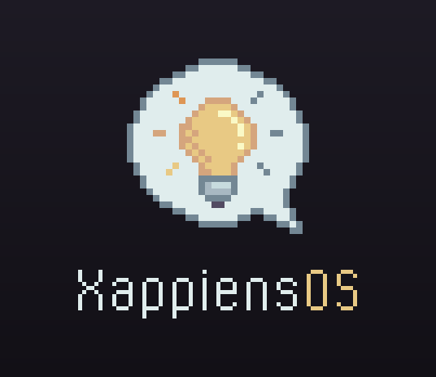

# Pantalla de arranque (Plymouth)



La bombilla del logo se enciende y "respira" con un halo cálido mientras sus
rayos se iluminan en círculo, como indicador de carga. Debajo, "XappiensOS"
con la fuente pixelada del logotipo ("OS" en el ámbar de la bombilla).

## Cómo está hecho

- Motor **two-step** de Plymouth, el mismo que usa Pop!_OS: está escrito en C
  y no ejecuta scripts, así que el coste en el arranque es mínimo. Todo el tema
  ocupa unos 35 KiB dentro del initramfs.
- `watermark.png` es el logo estático. `throbber-0001…0030.png` es sólo la
  capa que cambia (bombilla, halo, rayos y "OS"); Plymouth la reproduce en
  bucle cada 2 s encima del logo. Los dos tienen el mismo tamaño y la misma
  alineación, así que encajan píxel a píxel con cualquier resolución.
- `lock.png`, `entry.png`, `bullet.png` y `capslock.png` forman el diálogo de
  la contraseña del disco cifrado, en el mismo estilo pixel-art.

## Paleta

| Uso | Color |
| --- | --- |
| Fondo (degradado) | `#1D1A24` → `#121016` |
| Burbuja / texto "Xappiens" | `#E0EDED` |
| Contorno y rayos apagados | `#738794` |
| Bombilla / "OS" | `#E8C984` |
| Sombra de la bombilla | `#D5A57D` |
| Rayo encendido | `#DE9654` |
| Brillo | `#FAF9C6` |
| Tinta del logo | `#524B62` |

## Modificarlo

No edites los PNG a mano: todo sale de las rejillas de píxeles de
[`make-theme.py`](make-theme.py) (burbuja, fuente, colores, tiempos).
Tras cambiar algo:

```bash
python3 branding/plymouth/make-theme.py
```

El script sólo usa la biblioteca estándar de Python. Regenera el tema en
`config/xappiens-os/includes.chroot/usr/share/plymouth/themes/xappiens/` y
la vista previa `preview.png` (PNG animado).

## Probarlo sin construir la ISO

Desde una consola de texto (Ctrl+Alt+F3), en este mismo equipo:

```bash
branding/plymouth/test-local.sh 10 --password
```

Muestra la pantalla 10 segundos (con `--password`, también el diálogo de
contraseña) y luego deja el tema que había.

## Integración en la ISO

- El overlay `includes.chroot` copia el tema a `/usr/share/plymouth/themes/xappiens/`.
- `config/xappiens-os/hooks/chroot/20-plymouth.sh` lo fija como tema por
  defecto (alternativa `default.plymouth` en modo manual y `plymouthd.conf`).
- El initramfs se regenera con dracut en la etapa `live`; la línea del kernel
  ya incluye `quiet splash`.
