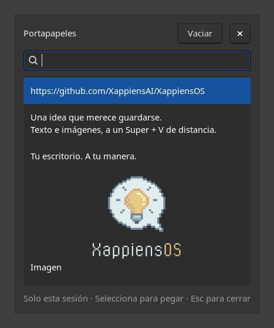

# Historial del portapapeles

<p align="center">
  
</p>

<p align="center"><sub>La herramienta real en una sesión Wayland aislada, con contenido de ejemplo.</sub></p>

El historial de XappiensOS se inicia automáticamente en las sesiones COSMIC.
**Super + V** abre un diálogo para recuperar texto e imágenes copiados durante
esa sesión y pegarlos en la aplicación anterior. El botón de vaciar elimina las
entradas del historial. No hay un archivo de historial ni sincronización entre
sesiones.

El diálogo permite buscar y seleccionar con las flechas y Enter. Escape o
Super + V lo cierran. Se guardan hasta 200 entradas, con un máximo de 8 MiB por
entrada y 64 MiB en total; al alcanzar el límite se descartan las más antiguas.

El alcance es texto sin formato e imágenes compatibles con GTK. No conserva el
formato enriquecido de un documento ni ofrece un historial de archivos. Las
aplicaciones que no admiten Shift + Insert pueden requerir pegar manualmente
la entrada seleccionada. Las capturas que `wl-paste` marca con
`CLIPBOARD_STATE=sensitive` no se incorporan al historial.

## Instalación e integración

La ISO instala `python3-gi`, GTK 3, GtkLayerShell, `wl-clipboard`,
`libwayland-client0`, `libxkbcommon0` y `xkb-data`. El pegado usa un pequeño cliente de
teclado virtual Wayland con un mapa XKB completo.
El paquete `xappiens-default-settings` declara las mismas dependencias y lleva
el mismo overlay. El archivo de inicio automático sólo se activa en COSMIC e
inicia `xappiens-clipboard-history.service` del usuario. El servicio ejecuta
`/usr/lib/xappiens/clipboard-history --daemon`, sin abrir una ventana, y se
detiene al cerrar la sesión incluso si el gestor del usuario sigue activo.
El mismo programa sin argumentos abre o cierra el diálogo.

`configure-desktop` copia la configuración de atajos distribuida por COSMIC y
añade Super + V. Publica el directorio completo mediante un enlace atómico en
`/etc/xappiens/cosmic/com.system76.CosmicSettings.Shortcuts/v1`. Es necesario
copiar también `system_actions`: `cosmic-config` elige un directorio completo,
no busca cada clave por separado entre varios directorios.

El archivo de `profile.d` y un generador de entorno de `systemd --user` anteponen
`/etc/xappiens` a `XDG_DATA_DIRS` conservando sus demás rutas y sin duplicar el
prefijo. El generador se ejecuta después de los de `environment.d` y Flatpak.
COSMIC busca aquí los valores por
defecto del sistema; no busca automáticamente en `/etc/cosmic`. Las preferencias
del usuario en `~/.config/cosmic` siguen teniendo prioridad, incluidos sus
atajos personalizados. No se modifica ningún archivo de configuración suyo.
El perfil registra también la variable en el gestor del usuario, para cubrir
la primera sesión tras instalar el paquete si ese gestor ya estaba activo.

El hook de la ISO y el `postinst` generan estos valores por defecto. Un hook de
APT los actualiza después de las operaciones de paquetes, por lo que futuras
versiones de COSMIC siguen aportando sus nuevos atajos. Si cambia el formato
de origen, se conserva la última configuración generada y se emite un aviso.
Un manifiesto detecta cambios manuales dentro del directorio generado y los
conserva también al actualizar o desinstalar. La desinstalación sólo retira los
archivos generados por XappiensOS que siguen intactos. Los archivos de `/etc`
que son configuraciones del paquete siguen las reglas habituales de `dpkg`:
se conservan con `remove` y se eliminan con `purge`. El inicio automático se
omite si ya no está instalado el ejecutable del historial.

Tras instalar o actualizar el paquete hay que volver a iniciar sesión para que
el compositor reciba el entorno y arranque el historial. No se reinicia el
escritorio durante la instalación.

## Validación en una sesión COSMIC de prueba

1. Instalar la ISO o `xappiens-default-settings` y volver a iniciar sesión.
2. Copiar dos textos distintos desde aplicaciones diferentes. Abrir Super + V
   y comprobar que aparecen en orden de recencia sin entradas vacías.
3. Seleccionar el texto anterior y comprobar que se pega en un editor que
   admita Shift + Insert, con el cursor y la ventana de destino conservados.
   Repetir en COSMIC Terminal.
4. Copiar una imagen y pegarla desde el historial en una aplicación que admita
   imágenes. Comprobar también texto con acentos, saltos de línea y emojis.
5. Con el mosaico de COSMIC activado, comprobar que el diálogo flota, se puede
   recorrer con el teclado y se cierra con Escape y repitiendo Super + V.
6. Vaciar el historial, cerrar el diálogo y volver a abrirlo. Comprobar el
   estado vacío. Copiar de nuevo para verificar que sigue capturando.
7. Cerrar sesión y entrar de nuevo: las entradas anteriores ya no deben estar.
   Verificarlo también con el usuario configurado con `loginctl enable-linger`.
8. Comprobar un segundo usuario, la sesión live y una configuración con varias
   pantallas. Verificar que los atajos personalizados ajenos siguen funcionando.
9. Actualizar los paquetes de COSMIC y comprobar que se conservan sus nuevos
   atajos junto con Super + V. Desinstalar `xappiens-default-settings` y verificar
   que los atajos originales vuelven en la siguiente sesión.

Las pruebas automáticas trabajan en directorios temporales y no cambian el
escritorio ni el portapapeles del equipo:

```bash
/usr/bin/python3 -m unittest discover -s tests -v
```

La prueba IPC usa GTK con Broadway y una sesión D-Bus privada. La prueba Wayland
opcional requiere Sway, `grim`, `wtype` (sólo para simular la navegación de
prueba) y GtkLayerShell; inicia un compositor sin pantalla con renderizado por software.
Comprueba la captura de texto e imágenes, la navegación, el pegado automático en
la ventana anterior, la restauración de imágenes y el borrado del historial.
Estas pruebas se omiten si faltan sus herramientas o el sandbox impide crear los
sockets temporales. La validación de la ISO con COSMIC y varias pantallas sigue
la lista manual anterior.
